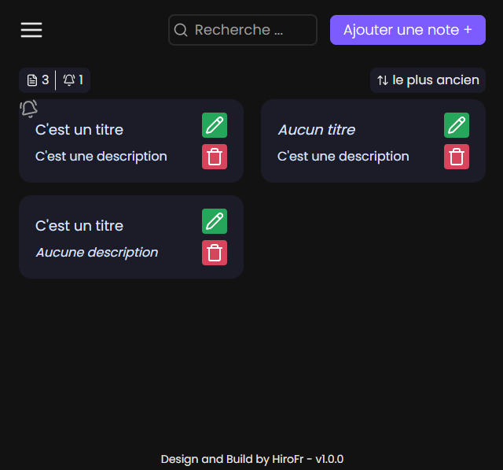

# HiroToDo


[](https://react.dev)
[](https://zustand.docs.pmnd.rs/getting-started/introduction)
[](https://lucide.dev)


A Chrome extension for taking notes and the ToDo-List

> This project is a complete rework of the Chrome extension "HiroToDo", originally available at the repository: [HiroToDo-Initial](https://github.com/HiroFr/HiroToDo-Initial).

This redesign is built with ReactJS and aims to improve the user interface, performance and overall user experience compared to the initial release.

<center></center>
<div style="text-align: center;">Presentation of the HiroToDo v1.0.0</div>

<div style="text-align: center; font-style: italic;">Design and Build by HiroFr with ❤️</div>

## 📌 Important

- All data is stored locally in your browser.
- ⚠️ **Warning:** This extension is not intended to store passwords.

---

## Requires

`NodeJS` / `Npm` / `Your terminal`

## Installation

_Note : The `dist folder` contains the extension._

### Install via git 💻

```bash

git clone https://github.com/HiroFr/HiroToDo.git

```

- You must be on the main branch for to have a version stable

- Open your browser then go to extension `chrome://extension`, **enable developer mode** and click on **load unpacked** enter in **HiroToDo folder** and select **dist folder**.

### Install via zip 📥

- Download the zip file from the git repository "HiroToDo"

- Unzip

- Open your browser then go to extension `chrome://extension`, **enable developer mode** and click on **load unpacked** enter in **HiroToDo folder** and select **dist folder**.

## Update ✅

If you use the command git :

    - git pull

    - restart the extension

If you use the zip file :

    - download zip file on branch main

    - unzip and replace the previously installed extension folder

    - restart the extension

## Features 🛠️

- Adding, Editing and deleting a Note/Todo
- Possibility of adding a notification for the Note/Todo
- Selecting the Light or Dark theme (Default: Light)
- Dynamic search bar
- Possibility of exporting and importing your data
- Complete re-design of the extension
- Show the number of items
- Show the number of active notifications
- Filter to newer or older